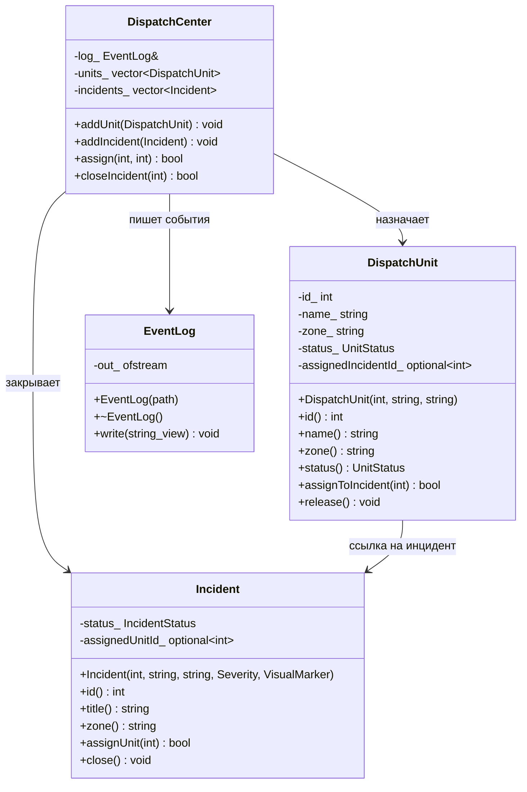

# dispatcher_trainer — Лабораторная работа 4

Объектная модель диспетчерского тренажёра: классы, инкапсуляция,
конструкторы и RAII в C++17/20.

## Вариант

**Транспортный узел.** Диспетчер управляет подразделениями
(бригада, дрон, техник) и инцидентами (задымление, отключение питания).
Задел под будущую визуализацию — поле `VisualMarker` (Alert, Repair и т. д.).

## Структура проекта

```
dispatcher-trainer/
├── .devcontainer/
│   ├── devcontainer.json
│   └── Dockerfile
├── .vscode/
│   ├── extensions.json
│   ├── launch.json
│   ├── settings.json
│   └── tasks.json
├── include/dispatcher/
│   ├── DispatchTypes.hpp
│   ├── DispatchUnit.hpp
│   ├── Incident.hpp
│   ├── EventLog.hpp
│   └── DispatchCenter.hpp
├── src/
│   ├── DispatchTypes.cpp
│   ├── DispatchUnit.cpp
│   ├── Incident.cpp
│   ├── EventLog.cpp
│   ├── DispatchCenter.cpp
│   └── main.cpp
├── CMakeLists.txt
└── README.md
```

## Сборка и запуск

```bash
cmake -S . -B build -DCMAKE_BUILD_TYPE=Debug
cmake --build build
./build/dispatcher_trainer
```

В VS Code: CMake: Configure → CMake: Build → Run Without Debugging.
Отладка: Run and Debug → Debug dispatcher_trainer (CodeLLDB).

## Классы

- **DispatchUnit** — подразделение: id, имя, зона, статус
  (Available / Busy / Maintenance / Offline), ID назначенного инцидента
  (`std::optional<int>`). Инварианты: id > 0, имя и зона непустые —
  при нарушении выбрасывается `std::invalid_argument`.
- **Incident** — инцидент: id, заголовок, зона, `Severity`, `VisualMarker`,
  статус (Open / Assigned / Closed). Те же инварианты в конструкторе.
- **EventLog** — RAII-журнал: открывает `dispatch.log` в конструкторе
  (режим дозаписи), закрывает в деструкторе, пишет события методом
  `write()`. Ручное закрытие файла в коде не требуется.
- **DispatchCenter** — координатор: `addUnit`, `addIncident`, `assign`
  (проверяет существование объектов, статус подразделения Available,
  статус инцидента Open, фиксирует несовпадение зон в журнале),
  `closeIncident`, `printUnits`, `printIncidents`, `printState`.

## Демонстрационный сценарий

`main.cpp`: создание журнала и центра, добавление трёх подразделений
(Brigade A, Drone 1, Technician B) и двух инцидентов (задымление,
отключение питания), два успешных назначения, закрытие инцидента 100,
отклонённая повторная попытка назначить занятое подразделение 1
на инцидент 101. Все события фиксируются в `dispatch.log`.

## Mermaid-схема



## Ограничения текущей реализации

- нет сетевого обмена, GUI, форматов JSON/INI — только консольный сценарий;
- `VisualMarker` — поле данных, реальной AR-визуализации пока нет;
- несовпадение зон при назначении фиксируется в журнале,
  но не блокирует операцию;
- после закрытия инцидента подразделение остаётся Busy —
  освобождение выполняется отдельным вызовом `release()`.