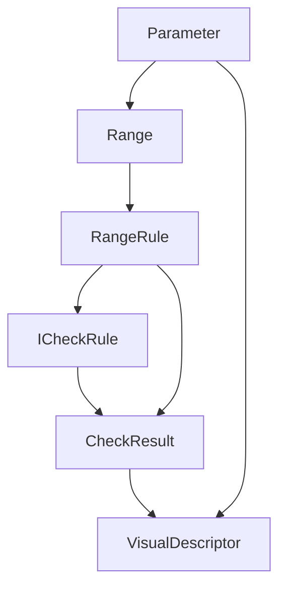
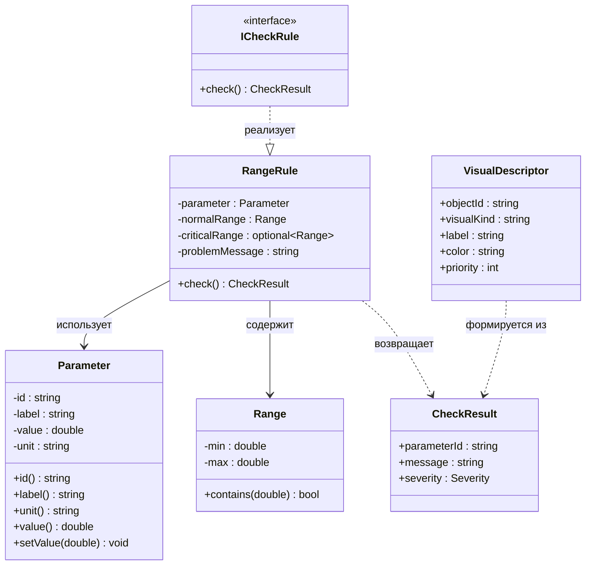
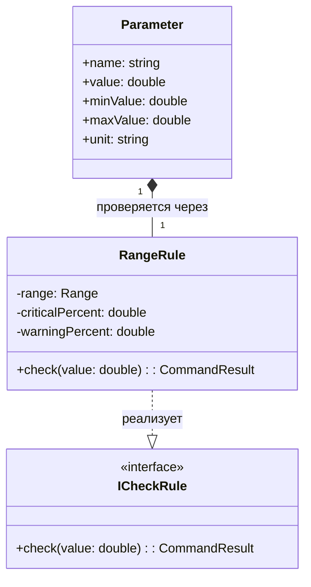

# dispatcher_trainer — Лабораторная работа 8: Modern C++ State

Цель работы: применить современные возможности C++ (C++17/20) для безопасной обработки состояний и команд в ядре диспетчерского тренажёра.

## Реализованные технологии

- **`std::optional`** — безопасный поиск параметров без «магических» значений вроде `-1`. Если параметр не найден, возвращается `std::nullopt`.
- **`std::variant`** — строгая типизация результатов команд: `CommandOk`, `CommandWarning`, `CommandError`. Вывод сообщения через `std::visit`.
- **`std::filesystem`** — сохранение журнала событий в файл `logs/dispatch_session.txt`.

---

## Проверяемые сценарии (пороговая логика)

| Сценарий | Значение | Ожидаемый результат | Логика порога |
|----------|----------|---------------------|---------------|
| Норма | 60.0 | Команда принята | В пределах [0..80] |
| Критическая зона (2%) | 79.0 | Критическая близость границы | 80 − (80 × 0.02) = 78.4 |
| Зона предупреждения (5%) | 77.0 | Предупреждение | 80 − (80 × 0.05) = 76.0 |
| Вне диапазона | 100.0 | Ошибка: значение вне диапазона | > 80 |

---

## Основные команды консольного меню

- `find <name>` — поиск параметра (использует `std::optional`).
- `set <param> <val>` — изменение параметра (результат в `std::variant`).
- `save` — сохранение журнала (через `std::filesystem`).
- `log` — просмотр журнала событий.

---

## Примеры работы (вывод в консоль)

**Поиск параметра:**

```text
find V-101
Найден: V-101 = 60 км/ч [0..80]

find NOPE
Параметр "NOPE" не найден.
```

**Изменение параметра:**

```text
set V-101 70.0
Команда принята: V-101 = 70

set V-101 90.0
Внимание: значение V-101 вне диапазона [0.000000..80.000000]
```

**Сохранение журнала:**

```text
save
Журнал сохранён: logs/dispatch_session.txt
```

---

## Сборка и запуск

### Основной способ: devcontainer (VS Code)

1. Установить Docker и VS Code.
2. Установить расширение **Dev Containers**.
3. Открыть папку проекта в VS Code.
4. Выполнить команду **Reopen in Container**.
5. Дождаться сборки контейнера, открыть встроенный терминал и выполнить:

```bash
cmake -S . -B build-debug -DCMAKE_BUILD_TYPE=Debug
cmake --build build-debug
./build-debug/dispatcher_trainer
```

### Альтернативный способ: Linux VM (VirtualBox)

В виртуальной машине Linux инструменты устанавливаются напрямую, а не через Dockerfile — среда зависит от того, что установлено в самой VM.

```bash
sudo apt update
sudo apt install -y build-essential cmake git gdb
cmake -S . -B build-debug -DCMAKE_BUILD_TYPE=Debug
cmake --build build-debug
./build-debug/dispatcher_trainer
```

> Базовый devcontainer-образ Microsoft (`mcr.microsoft.com/devcontainers/cpp:1-debian-12`) выбран вместо голого `ubuntu:24.04` из-за ограничений сети: образ кешируется целиком, а список устанавливаемых пакетов зафиксирован в Dockerfile, поэтому воспроизводимость среды сохраняется.


## Диаграмма 1: Поток данных



## Диаграмма 2: Классы правил и проверок



## Диаграмма 3: Ключевой фрагмент для ЛР 8



---

## Изменения в ЛР 9

- оформлена история Git;
- создана рабочая ветка;
- выполнено слияние;
- разобран простой конфликт;
- уточнён демонстрационный сценарий.

## Изменения в ЛР 10

- исходники ядра перенесены в `src/core` (`model.cpp`, `log.cpp`, `commands.cpp`), консольное приложение — в `src/app`;
- проект разделён на статическую библиотеку `dispatcher_core` и приложение `dispatcher_trainer`;
- стандарт C++20 задан через `target_compile_features` на уровне цели;
- сборка ведётся в двух конфигурациях: `build-debug` и `build-release` (out-of-source);
- тесты линкуются с библиотечным ядром вместо пересборки исходников;
- проверена идентичность вывода приложения в Debug и Release.

## Изменения в ЛР 11

- добавлен каталог `.devcontainer` с `Dockerfile` и `devcontainer.json` — проект открывается в VS Code внутри контейнера (**Dev Containers: Reopen in Container**);
- базовый образ — `mcr.microsoft.com/devcontainers/cpp:1-debian-12`; в контейнер устанавливаются cmake, ninja-build, git, clang, clangd, clang-format, lldb, gdb, pkg-config, ca-certificates;
- версия образа и список пакетов зафиксированы в репозитории — среда сборки воспроизводима и не зависит от конфигурации компьютера;
- сборка и запуск выполняются из терминала внутри контейнера: `cmake -S . -B build-debug -DCMAKE_BUILD_TYPE=Debug`, `cmake --build build-debug`, `./build-debug/dispatcher_trainer`;
- `.gitignore` исключает каталоги сборки (`build/`, `build-debug/`, `build-release/`, `cmake-build-*/`) — исходники отделены от артефактов;
- изменения зафиксированы коммитом `Add devcontainer for reproducible C++ environment`.

## Ограничения первого модуля

Проект остаётся локальным консольным тренажёром. JSON/INI, сеть, GUI, процессы, потоки, устройства и CI/CD в рамках работы не используются.